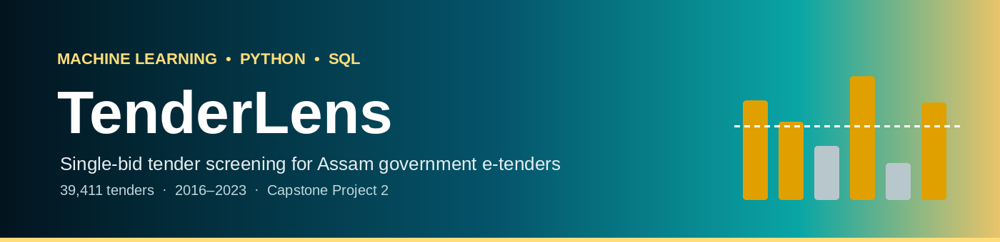
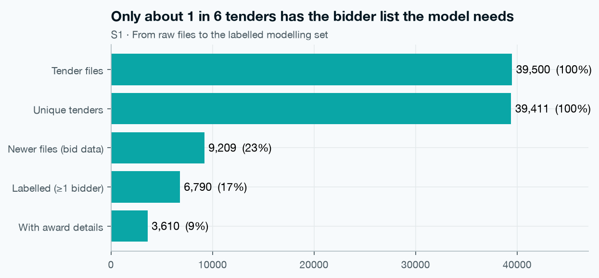
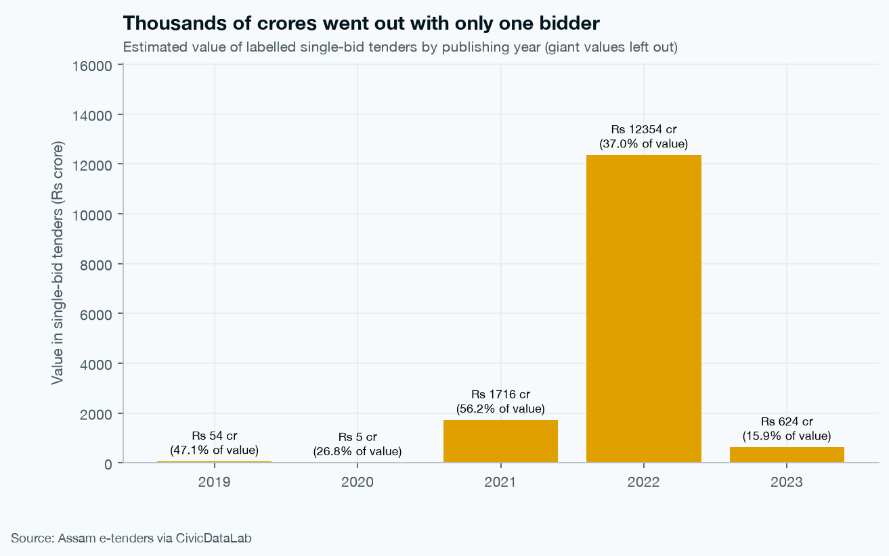
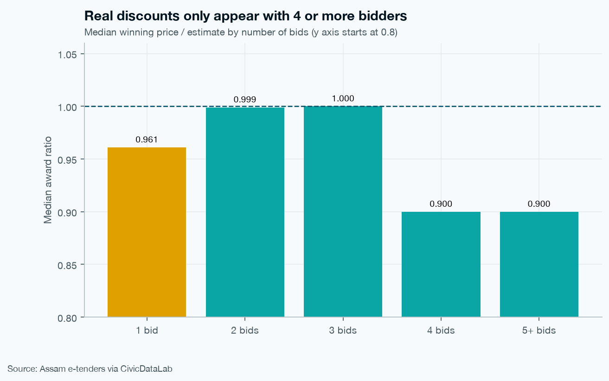
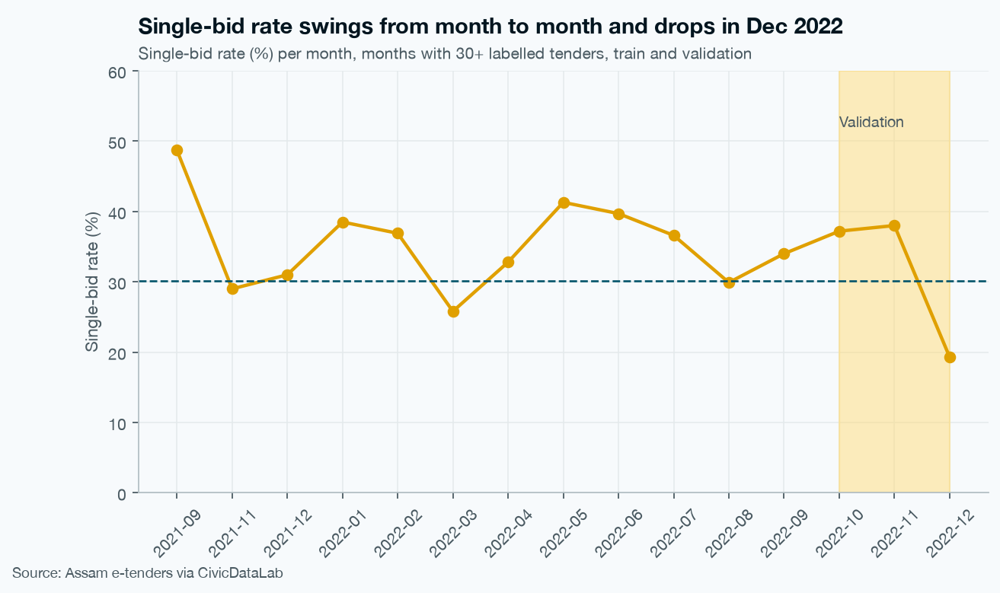
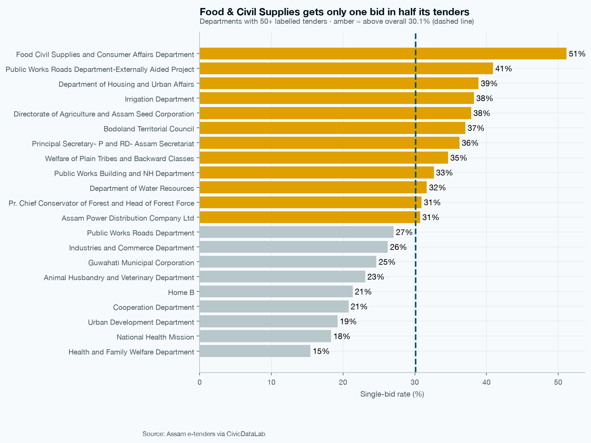
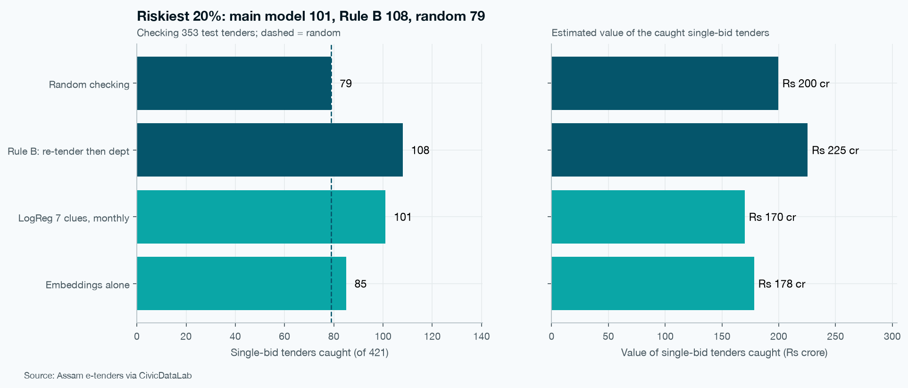
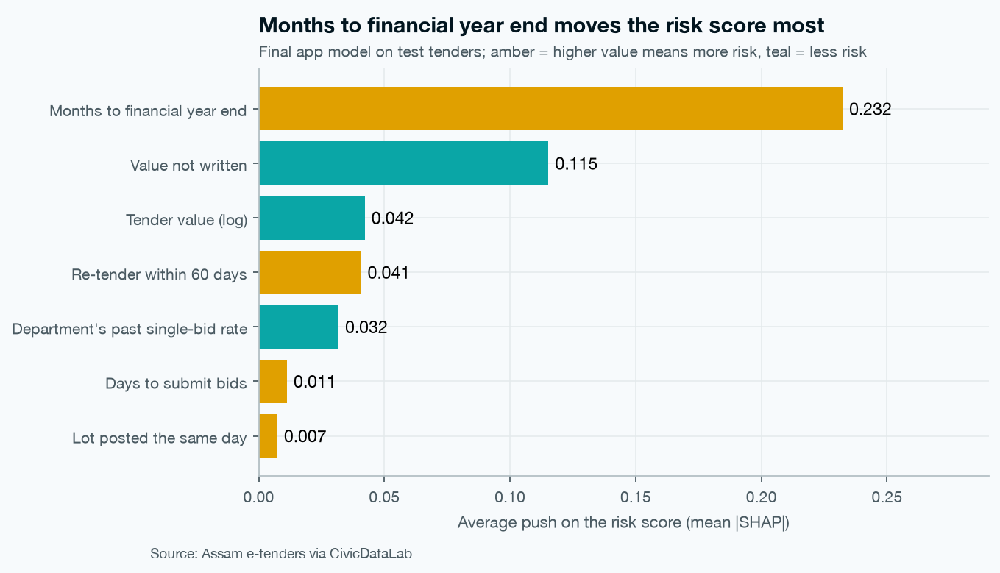
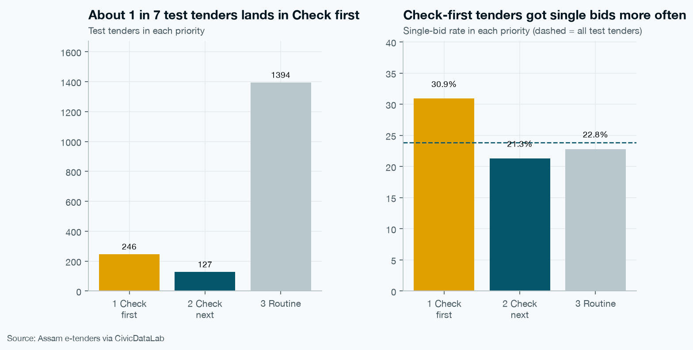

**A machine learning project that learns from 39,000+ real Assam government e-tenders to flag which new tenders are likely to get only one bid, explains why, and puts it all in a live app so auditors know where to look first.**

**[Open the live app](https://tenderlens-sindhu.streamlit.app/)** · **[Read the final report (PDF)](docs/Sindhu_Marupaka_PGA56_Capstone2_Final_Report.pdf)** · **[See the slides (PDF)](docs/TenderLens_Capstone2_Presentation.pdf)**

        

> TenderLens is a screening tool, not fraud detection. A single bid does not mean anything wrong happened. It only means nobody competed on price, which is worth a closer look. A person always decides.

---

## Project at a Glance

| Section | What I did | Main result |
|---|---|---|
| S1 Data audit | Checked 39,500 tender files | 6,790 tenders have a real bidder list |
| S2 Cleaning | 16 cleaning steps, cleaning log, data dictionary | 39,411 unique tenders |
| S3 EDA and SQL | 7 charts, every number checked again in SQLite | 30.1% of tenders got only one bid |
| S4 Features and split | 7 publish-day clues, time-based split | Train 2,753 / validation 2,270 / test 1,767 |
| S5 Models | Rule benchmark, Logistic Regression, Random Forest, XGBoost | Patterns changed after Sep 2022 (drift) |
| S6 NLP | TF-IDF vs sentence embeddings on tender titles | Text explained the change, but did not beat random reliably |
| S7 Final test | One fair test on Jan to May 2023, SHAP | Riskiest 20%: 101 caught vs 79 by random checking |
| S8 Money and anomalies | Value at risk, price vs competition, Isolation Forest | Rs 14,752 crore went out with one bidder |
| S9 Deep learning | Neural network and autoencoder | Did not beat the simpler models, so not used |
| S10 App | 8-page Streamlit app with plain-English review briefs | Live at tenderlens-sindhu.streamlit.app |

---

## Business Understanding

When a government office posts a tender, it wants many companies to bid. More bids usually means better prices and fairer selection. When only one company bids, there is no competition on price.

Auditors cannot check every tender by hand. So my question was:

- Can past tenders help predict which new tenders are likely to get only one bid, on the day they are published?
- Can I explain why, so the result is useful and not a black box?
- How much money is involved, and where should someone look first?

---

## Data Understanding

- **Source:** Assam e-tenders portal, collected and shared by [CivicDataLab](https://github.com/CivicDataLab/assam-tenders-data).
- **Period:** April 2016 to May 2023.
- **Size:** 39,500 CSV files, one file per tender. Tender details, bidder list, award and cancellation are all columns inside each file.

| Stage | Count |
|---|---|
| Tender files | 39,500 |
| Unique tenders (89 duplicates removed) | 39,411 |
| Tenders with a bidder list (usable for the target) | 6,790 |
| Single-bid tenders | 2,044 (30.1%) |



The raw data is not in this repo because it is large and has company names. Supplier names in the app are anonymised (S1, S2 and so on).

---

## Methodology

1. **Clean and check** the data (S1, S2), and confirm every key number twice, once in pandas and once in SQL (S3).
2. **Build clues known on the publish day only** (S4): department's past single-bid rate, tender value, value missing, bid window, months to financial year end, same-day lots, quick re-tender.
3. **Split by time, not randomly:** train up to Sep 2022, validation Oct to Dec 2022, test Jan to May 2023. Tenders sharing a reference number stay in one set.
4. **Compare against two benchmarks:** random checking and a simple rule (Rule B: quick re-tender first, then department rate).
5. **Lock the plan, then test once** on Jan to May 2023 (S7). The plan was saved before the test (`reports/s7_locked_plan.csv`).
6. **Explain** each tender with SHAP, and flag odd tenders separately with Isolation Forest (S8).
7. **Try complex models fairly** (S9) and keep them only if they clearly beat the simple ones.
8. **Build the app** (S10) with risk bands ranked inside each month, reasons, unusual flags and a plain-English review brief.

---

## Key Findings

**1. One-bid tenders hold more than a third of the money.**
Single-bid tenders are 31% of tenders with a value, but 36.5% of the money: about Rs 14,752 crore. The top 3 departments hold 75% of that money.



**2. Real price discounts only appear with 4 or more bidders.**
With 1 to 3 bidders, the winning price is close to the estimate. With 4+ bidders, the median winning price drops to about 90% of the estimate. The rough cost of having only one bidder is Rs 120 to 680 crore. This is a sign, not proof.



**3. Single bids fell after Sep 2022, and the patterns changed.**
36% in training, 28% in validation, 24% in test. 13 of 15 big departments got better, but BTC got worse (24.7% to 39.9%). This drift is why many models struggled.



**4. Some offices see far more single bids than others.**
Food and Civil Supplies is highest at 51%. Health and Family Welfare is lowest at 15%.



**5. Re-posting a tender did not bring more bidders.**
Tenders posted again within 1 to 60 days got single bids 40% of the time, compared to about 30% for first-time tenders.

---

## Model Results (one fair test, Jan to May 2023)

Test set: 1,767 tenders, 421 of them single-bid (23.8%). An auditor checks the riskiest 20% (353 tenders).

| Method | Single-bid tenders caught in the riskiest 20% |
|---|---|
| Random checking | 79 |
| TenderLens model (Logistic Regression, 7 clues) | 101 |
| Simple rule (Rule B) | 108 |



- The model beat random checking in 95.8% of 500 re-draws. It is a small but real win.
- The simple rule did slightly better on this test. I report that openly; a strong simple rule is a useful finding too.
- Risk bands work in the right order: High 28.6%, Medium 24.9%, Low 21.3% real single-bid rate.
- SHAP shows the biggest clues are the time of the financial year and whether the value was left empty.



**Unusual tenders (Isolation Forest):** 74 test tenders were flagged as unusual. 54 of them were already in the High band, so the flag mostly adds the reason, meaning which clue is odd. A simple "check first" rule (High band and either unusual or worth Rs 1 crore+) picked 246 tenders with a 30.9% single-bid rate.



---

## What Did Not Work (and why I kept it simple)

- **Random Forest and XGBoost** did not beat random checking on validation, because patterns changed after Sep 2022.
- **Sentence embeddings** of tender titles helped explain the change (new scheme names, a December road-work wave) but did not prove a win over random (83% of re-draws).
- **Neural network (ANN):** 0.286 vs random 0.288 on validation, and unstable across seeds (2 of 6 above random). It did not earn its place, so Logistic Regression stays.
- **Autoencoder** found a real data error (a Solar PV Plant valued at Rs 3,000), but it flagged too many tenders under drift. Isolation Forest stays.
- **K-Means** was skipped. Grouping tenders would not change which tender to check first.

---

## The TenderLens App

**[tenderlens-sindhu.streamlit.app](https://tenderlens-sindhu.streamlit.app/)**

| Page | What it does |
|---|---|
| Overview | Monthly summary, money at risk, model health |
| Tender risk list | Ranked list with audit budget slider, search and CSV download |
| Tender detail | Risk band, SHAP reasons, unusual clues, similar past tenders, review brief, PDF |
| Department report card | Before/after rate, single-bid money, repeat winners |
| Model health | Monthly catch rate and drift warning |
| Score new tenders | Score one tender or upload a CSV |
| Beat the model | A small game: can you pick risky tenders better than the model? |
| About | How it works, limits and data source |

**GenAI review brief:** for a flagged tender, an LLM can write a short plain-English brief using only the tender's real fields, SHAP reasons and unusual flag. Every number is fact-checked against the data, and a template brief is used when no API key is set.

---

## Business Impact / Recommendations

- Check the "check first" list each month instead of random tenders.
- Look closely at departments with high single-bid money (APDCL, PWD Building & NH, PWD Roads EAP) and at departments that got worse (BTC).
- Encourage 4+ bidders on big works, since that is where real discounts appear.
- Retrain the model every month on tenders whose bids are already opened.

---

## Skills Demonstrated

- Data cleaning and auditing at scale (39,500 files), SQL checks in SQLite
- Feature engineering without leakage, time-based validation, bootstrap testing
- Logistic Regression, Random Forest, XGBoost, TF-IDF, sentence embeddings, ANN, autoencoder
- SHAP explanations, Isolation Forest anomaly detection
- Business framing in rupees and auditor workload
- Streamlit app design and deployment, GenAI with fact checks

---

## Challenges & What I Learned

- **Drift is real.** A model that looks fine on old data can fail on new months, so I tested on future months only.
- **Leakage hides everywhere.** Bid counts, award values and amendments are only known later, so I never used them as inputs.
- **Simple can win.** A one-line rule was hard to beat, and saying so honestly is part of good analysis.
- **Complexity must earn its place.** I tried deep learning properly, measured it, and chose not to use it.

---

## Limitations

- Only 6,790 tenders have a bidder list, so the model learns from a smaller part of the data.
- The win over random checking is small, and patterns keep changing over time.
- Risk scores are rankings, not real percentages, so the app shows bands.
- A single bid is a reason to review, never proof of wrongdoing.

---

## Future Improvements

- Monthly automatic retraining with a drift alarm
- More data from other states to learn steadier patterns
- Better location data (only 64.5% of location text matched a district)
- Feedback from auditors on which flags were useful

---

## Project Structure & How to Run

```
tenderlens-single-bid-prediction/
├── notebooks/        01 to 09: data audit, cleaning, EDA, features, models, NLP, final model, anomaly, deep learning
├── app/              Streamlit app (app.py, 8 pages in views/, app_data/, models/)
├── reports/          61 result tables, model card, and figures/ with 96 charts
├── models/           saved models (Logistic Regression, Isolation Forest, ANN)
├── sql/              eda_queries.sql
├── docs/             final report and presentation (PDF)
├── tenderlens_style.py   chart colours and helpers
└── banner.png
```

**Run the app on your computer:**

1. `cd app`
2. `pip install -r requirements.txt` (Python 3.11)
3. `streamlit run app.py`

**Run the notebooks:** download the raw data from [CivicDataLab](https://github.com/CivicDataLab/assam-tenders-data), place the zip in `data/raw/`, and run the notebooks in order from 01 to 09.

---

## Acknowledgements

- Data: Assam e-tenders portal via [CivicDataLab](https://github.com/CivicDataLab/assam-tenders-data).
- Capstone Project 2, Post Graduate Program in Data Science and Analytics with GenAI, Imarticus Learning.

**Sindhu Sharma Marupaka** · [GitHub](https://github.com/sindhusharmamarupaka) · [LinkedIn](https://www.linkedin.com/in/sindhu-sharma-data-analyst)
